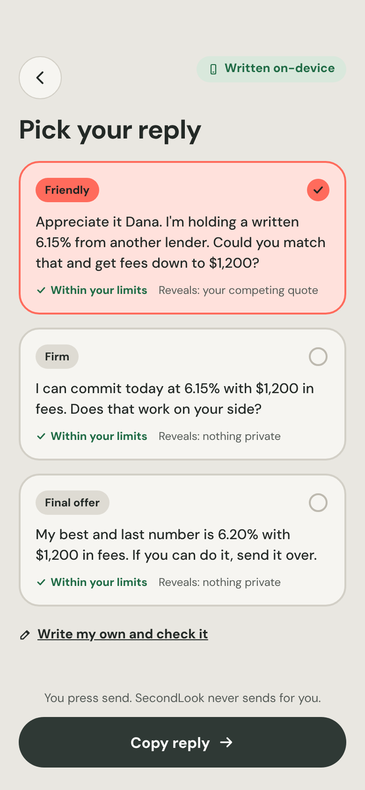
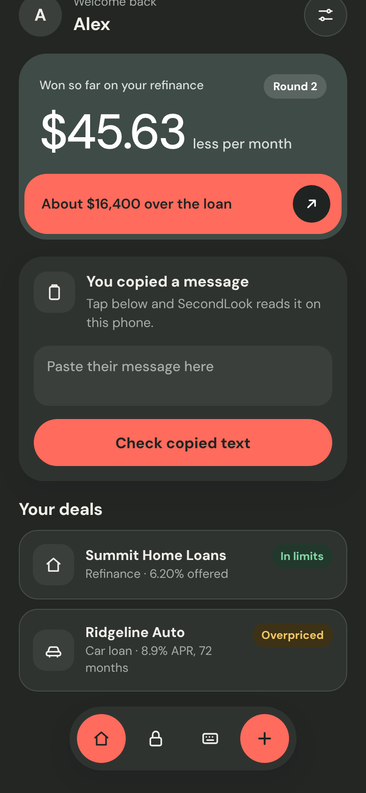
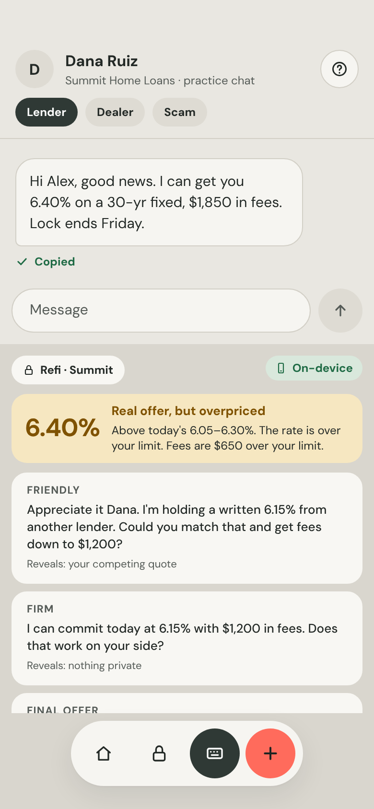
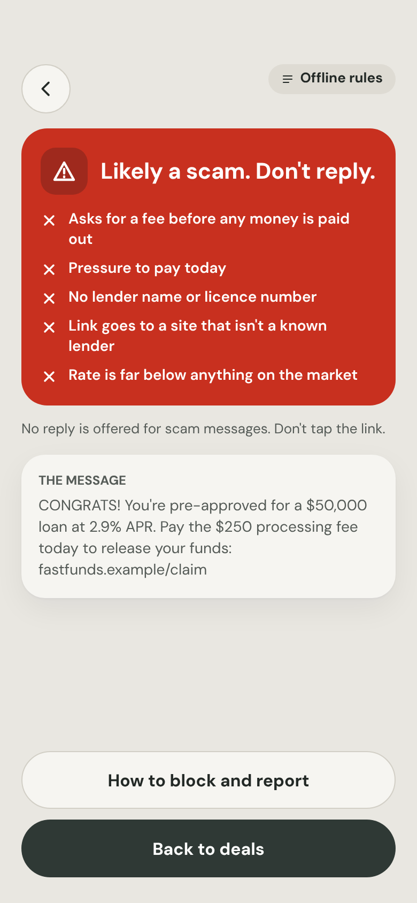

# SecondLook

**A second look at a loan quote before you reply to it.**

A lender or car dealer texts you a rate. Is it real? Is it a fair price? What do you say back
without giving away how high you would go? SecondLook reads the message on your phone, checks
it against limits you locked with a PIN, and writes three replies that stay inside those
limits. You press send. The lender's message and your limits never leave the phone.

Built for [#BuildHybridAI 2026](https://firebasehybridaihackathon.devpost.com/) with
**Firebase AI Logic hybrid inference**, on iPhone, Android and the web from one codebase.

> **The cloud knows the market. The phone knows you.**

SecondLook compares numbers and helps you word a reply. It is not a lender or a financial
adviser.

---

## Why hybrid inference is the product, not a detail

Most hybrid demos use on-device as a cheaper copy of the cloud. Here the two do different
jobs, and the split is the privacy promise:

| What happens | Where it runs | Firebase AI Logic mode | Why |
|---|---|---|---|
| Read the lender's message, decode rate, fees, term | On-device model | `ONLY_ON_DEVICE` | The message contains names and your situation. The SDK itself refuses the cloud. |
| Write three counter-offers | On-device model | `ONLY_ON_DEVICE` | Same. And the model writes words around placeholders; your numbers are filled in by code, so the walk-away rate is never in any prompt. |
| Check your own wording for leaks | Code, then on-device model | `ONLY_ON_DEVICE` | Your own words never go to the cloud. |
| Same steps when the device has no model | Cloud, **redacted** text | `PREFER_ON_DEVICE` | Names, phone numbers, links and account numbers are stripped first. The result is labelled "Cloud · redacted". |
| Today's market range, with sources | Cloud + Google Search grounding | `ONLY_IN_CLOUD` | The phone cannot know the market. Five coarse facts are sent (product, amount band, credit band, state) and shown to you as "What the cloud saw". Opt-in. |
| Loan math, limit checks, scam rules | Plain code | none | Arithmetic and safety checks should not depend on a model. Works in airplane mode. |

Every result carries a badge that says where it ran: **On-device**, **Cloud**,
**Cloud · redacted** or **Offline rules**.

Other Firebase products in use: **App Check** (all three platforms), **Remote Config** (scam
rules and model names can change without a release), **Anonymous Auth** (web), **Hosting**.

## What it does

- **Check**: verdict in one tap. Scam, needs more detail, overpriced, or competitive, with the
  money first ("About $23/mo above the top of today's range").
- **Counter**: three replies (friendly, firm, final offer). Each shows "Within your limits" and
  "Reveals: …" before you pick it.
- **Leak guard**: blocks a reply that names your walk-away rate, agrees to more than your
  limits, cites a quote you do not hold, or mentions your credit score or deadline when you
  said not to. Offers a safer version.
- **Scam gate**: fee-before-funds, pressure, unknown links and similar patterns. No reply is
  offered for a scam, and the message is never sent to any model.
- **Rounds**: a timeline of offers and counters with what you have won so far.
- **Where you type**: the same Check · Counter · Explain panel on every platform.

  | Platform | How you reach it |
  |---|---|
  | iPhone | **SecondLook keyboard** (switch with the globe key in any app; `targets/keyboard`). Also "Check copied text"; Send reopens Messages with the reply filled in. |
  | Android | **SecondLook keyboard** (an Android keyboard; turn it on from the Keyboard tab). Also highlight text in any app → "SecondLook" next to Copy and Share. |
  | Web / Chrome | **SecondLook for Chrome** ([extension/](extension/README.md)): select a lender's message on any site → right-click → SecondLook. The side panel shows the verdict and types the reply you pick into the page. A website cannot install a keyboard, so this is the web's equivalent. |

  In every case you press send yourself, and the walk-away rate is never typed or sent.

## Screens

| Verdict (on-device) | Verdict (cloud, redacted) | Pick your reply | Rounds |
|---|---|---|---|
|  |  |  |  |

| Home (dark) | Panel where you type | Scam |
|---|---|---|
|  |  |  |

These are rendered by the browser test harness with sample data. Replace them with device
screenshots before submitting.

## Where Firebase AI Logic is called

| Platform | File | What to look for |
|---|---|---|
| Web (Chrome, Gemini Nano) | [`src/ai/platform.web.ts`](src/ai/platform.web.ts) | `getAI`, `getGenerativeModel(ai, { mode: InferenceMode… })`, `response.inferenceSource` |
| iOS (Apple Foundation Models) | [`modules/secondlook-ai/ios/SecondLookAIModule.swift`](modules/secondlook-ai/ios/SecondLookAIModule.swift) | `FirebaseAI.firebaseAI`, `HybridModel(primary:secondary:)`, `generativeModelSession` |
| Android (Gemini Nano) | [`modules/secondlook-ai/android/…/SecondLookAIModule.kt`](modules/secondlook-ai/android/src/main/java/expo/modules/secondlookai/SecondLookAIModule.kt) | `Firebase.ai(...).generativeModel(onDeviceConfig = OnDeviceConfig(mode = …))` |
| All | [`src/ai/router.ts`](src/ai/router.ts) | The privacy router: the one place that decides which mode a prompt gets |

## Architecture

```
┌──────────────────────── Expo app (TypeScript) ─────────────────────────┐
│  Screens: Home · Deal File · Limits + PIN · Verdict · Drafts · Rounds  │
│  Engine (src/engine, pure TS): scam rules · redactor · loan math ·     │
│          leak guard · drafts · pack. 48 unit tests, no model needed.   │
│  AI router (src/ai/router.ts): private → on-device only,               │
│          redacted → hybrid, market range → cloud + Search grounding    │
└───────────────┬────────────────────────────┬───────────────────────────┘
                │ Expo module (Swift/Kotlin)  │ Firebase JS SDK (web)
                ▼                             ▼
        Firebase AI Logic hybrid inference
          on-device: Apple Foundation Models · Gemini Nano (AICore) · Gemini Nano (Chrome)
          cloud:     Gemini (+ Grounding with Google Search)
```

## Run it

Requires Node 22.13 or newer.

```bash
npm install            # if a version is rejected: npm run setup:deps
npx expo install --fix # aligns versions with the installed Expo SDK
npm test               # 48 engine tests
npm run web            # opens the app in a browser
```

With no Firebase configuration the app still runs: it uses the built-in rules, shows
"Offline rules" badges, and Settings says the cloud is "Not set up". To turn on the models,
follow **[SETUP.md](SETUP.md)** (about 30 minutes of console work).

Native builds use Expo development builds (not Expo Go), because of the native module:

```bash
npx expo run:android          # Android emulator or device
npx expo run:ios              # on a Mac
```

On Windows, the iOS build runs on GitHub Actions and is installed with Sideloadly; see SETUP.md.

### Try it without a real quote

Home → "Load sample deals" adds two made-up deals. The Keyboard tab is a practice chat with a
made-up lender, dealer and scam message. Sample numbers and names are fictional.

## Tests

```bash
npm test                 # engine: loan math, extraction, scam rules, redaction, leak guard, drafts, pipeline
npm run preview:build    # builds the screens for a headless browser (see tools/preview)
npm run preview:test     # 19 browser scenarios: full negotiation, cloud fallback, offline, scam, PIN, erase…
```

The browser tests replace Firebase with a fake that records every call, and assert on what
would have left the device. For example: in cloud-fallback mode the prompt contains the loan
numbers but not the user's name, the lender's name, a phone number or any limit.

## Status, honestly

| Part | State |
|---|---|
| Engine (TypeScript) | Unit-tested. Reproduces the worked example in the plan to the cent. |
| Screens and state | Tested in headless Chrome through a small stand-in for React Native (`tools/preview`). |
| Web adapter (`firebase/ai`) | Written against the current docs; exercised against a fake SDK, not yet against a live project. |
| iOS and Android native module | Compiled on GitHub Actions (iOS .ipa, Android APK). The hybrid APIs are marked Experimental by Firebase. |
| iOS keyboard extension | In `targets/keyboard` with a T1–T4 test bench ([docs/T1-T4.md](docs/T1-T4.md)); built by the iOS workflow; phone test pending. |
| Android app and keyboard | Driven end to end on an Android 14 emulator by `.github/workflows/android-emulator.yml` (screenshots in the job log). No Gemini Nano on emulators, so AI runs as the redacted cloud fallback there. |
| Chrome extension | Driven end to end in Chromium by `.github/workflows/extension-test.yml`: right-click → verdict → reply typed into the page; leak guard. |

## Privacy, in one place

- Limits, PIN and Deal File are stored on the device (Keychain / Keystore; browser storage on
  the web). There is no account and no server copy. "Erase everything" removes them.
- A private prompt is only ever given to an on-device model.
- The cloud sees either redacted text (only when there is no on-device model, and only if the
  setting is on) or the five coarse facts for the market range (only when you ask).
- Scam messages are judged by code and go nowhere.

## Built during the hackathon

Everything in this repository was created during the submission period (Nov 11–30, 2026).
Third-party pieces: Expo / React Native, the Firebase SDKs, and the DM Sans typeface (SIL Open
Font License). An AI coding assistant (Claude) was used to write code and tests.

## Licence

[Apache 2.0](LICENSE).
