# SecondLook

**A second look at a loan quote before you reply to it.**

Built for [#BuildHybridAI 2026](https://firebasehybridaihackathon.devpost.com/) · Firebase AI Logic hybrid inference · iPhone, Android and Chrome from one codebase

[](https://github.com/Husky-AI9/SecondLook/actions/workflows/test.yml)
[](#testing-it-as-a-judge)
[](#where-firebase-ai-logic-is-called)
[](#why-hybrid-inference-is-the-product)
[](#firebase-products-used)
[](#testing-it-as-a-judge)
[](LICENSE)

[Demo video](#demo-video) · [Live web app](https://secondlook-7b7d5.web.app) · [Chrome extension](extension/README.md) · [Test builds](#testing-it-as-a-judge) · [For judges](#for-judges) · [Where AI Logic is called](#where-firebase-ai-logic-is-called) · [Tests](#tests) · [Honest scope](#honest-scope)

<a href="docs/architecture/secondlook-architecture.svg"></a>

<sub>Animated diagram (opens full size): one lender message moving through SecondLook. Green is your phone, blue is the cloud. A static copy is in [docs/architecture](docs/architecture/secondlook-architecture.png).</sub>

**The cloud knows the market. The phone knows you.**

A lender or car dealer texts you a rate. Is it real? Is it a fair price? What do you say back
without giving away the highest rate you would accept? SecondLook reads the message on your
device, checks it against limits you locked with a PIN, and writes three replies that stay
inside those limits. It works where you type: a keyboard on iPhone and Android, and a side
panel in Chrome. You press send. The lender's message and your limits never leave the device.

SecondLook compares numbers and helps you word a reply. It is not a lender or a financial
adviser.

## For judges

| Criterion | What to look at | Where |
|---|---|---|
| **Technological implementation** | All three Firebase AI Logic inference modes, chosen per prompt by one privacy router. Native adapters for Apple Foundation Models (iOS), Gemini Nano through AICore (Android) and Chrome's built-in Gemini Nano (web). The same panel ships as an iPhone keyboard, an Android keyboard and a Chrome extension. App Check on every platform, Remote Config, Anonymous Auth, Hosting. Four automated test suites in CI. | [Where AI Logic is called](#where-firebase-ai-logic-is-called) · [`src/ai/router.ts`](src/ai/router.ts) · [Tests](#tests) |
| **Design** | One complete loop: check → verdict → counter → leak guard → rounds, with a savings counter. Every answer carries a badge saying where it ran. Light and dark. The panel appears where the negotiation actually happens, not in a separate chatbot. | [Screenshots](#screenshots) · [Where you type](#where-you-type) |
| **Potential impact** | Quotes for a refinance or a car loan arrive by text, and people answer them alone, often against a deadline. The two costly mistakes are replying with your walk-away number and replying to a scam that looks like an offer. SecondLook catches both before you send. | [The problem](#the-problem-and-who-its-for) |
| **Quality of the idea** | Hybrid inference is the privacy promise, not a cost saving: private text only ever reaches an on-device model, models write around placeholders so the walk-away rate is never in any prompt, and the cloud gets either redacted text or five coarse facts you can see. | [Why hybrid inference is the product](#why-hybrid-inference-is-the-product) · [Safety and privacy](#safety-and-privacy) |
| **Submission requirements** | Platforms, App Check, runtime use of Firebase AI Logic, licence, hosted build, video, no secrets in the repo. | [Submission checklist](#submission-checklist) |

## Submission checklist

| Requirement | How SecondLook meets it |
|---|---|
| Gen AI app with Firebase AI Logic and supported Firebase products | Firebase AI Logic hybrid inference, plus App Check, Remote Config, Anonymous Auth and Hosting ([table](#firebase-products-used)). |
| Web (Chrome): Gemini Nano via Firebase AI Logic | [`src/ai/platform.web.ts`](src/ai/platform.web.ts) uses `getGenerativeModel(ai, { mode: InferenceMode… })` with Chrome's built-in Gemini Nano. Hosted at **https://secondlook-7b7d5.web.app**, and packaged as a [Chrome extension](extension/README.md). |
| Android: Gemini Nano 4 via Firebase AI Logic | [`SecondLookAIModule.kt`](modules/secondlook-ai/android/src/main/java/expo/modules/secondlookai/SecondLookAIModule.kt) and the keyboard [`SecondLookKeyboardService.kt`](modules/secondlook-ai/android/src/main/java/expo/modules/secondlookai/SecondLookKeyboardService.kt) use `OnDeviceConfig(mode = InferenceMode…, modelOption = …)`; the default model option is the Gemini Nano 4 preview category. |
| iOS: Apple Foundation Models via Firebase AI Logic | [`SecondLookAIModule.swift`](modules/secondlook-ai/ios/SecondLookAIModule.swift) uses `FirebaseAI.SystemLanguageModel`, `HybridModel(primary:secondary:)` and `generativeModelSession`. |
| App Check (debug tokens accepted) | Enforced for Firebase AI Logic. Web uses reCAPTCHA Enterprise; the iOS and Android test builds use debug tokens injected at build time from GitHub secrets. |
| Firebase AI Logic imported and called at runtime | Every model call goes through [`src/ai/router.ts`](src/ai/router.ts) to the three adapters above (call sites [listed below](#where-firebase-ai-logic-is-called)). |
| Public repo with an open-source licence | [Apache 2.0](LICENSE). |
| Working project for testing | Hosted web app, Chrome extension, Android APK and iPhone .ipa: see [Testing it as a judge](#testing-it-as-a-judge). |
| Demo video (3 minutes or less, English, YouTube) | [Demo video](#demo-video). |
| No production keys, project secrets or personal data in the repo | Firebase config files and App Check tokens come from GitHub secrets at build time and are git-ignored. Every name and number in the samples is made up. |
| What was built during the submission period | [Built during the hackathon](#built-during-the-hackathon). |

## The problem, and who it's for

**The moment.** A mortgage lender or a car dealer texts you a quote: "6.40% on a 30-yr fixed,
$1,850 in fees. Lock ends Friday." You have to decide, usually alone and against a deadline,
whether it is real, whether it is fair, and what to say back.

**Who it's for.** People refinancing a home or financing a car who get quotes by text or email
and negotiate them without a broker.

**What goes wrong today.**
- Pasting the quote into a chatbot sends your situation, your lender's name and your limits to
  a server.
- One honest sentence ("the highest I can go is 6.25%") hands the lender your walk-away rate,
  and that is usually the rate you end up paying.
- "Pre-approved, pay the $250 processing fee to release your funds" texts look like real offers.

**What SecondLook does instead.**
- A verdict in one tap: scam, needs more detail, overpriced or competitive, with the money first.
- Three replies (friendly, firm, final offer) that stay inside the limits you locked, each
  labelled with what it reveals.
- A leak guard that stops a reply naming your walk-away rate and offers a safer version.
- A scam gate run by code: no reply is offered, and the message goes nowhere.

## Why hybrid inference is the product

Most hybrid demos use on-device as a cheaper copy of the cloud. Here the two do different
jobs, and the split is the privacy promise:

| What happens | Where it runs | Firebase AI Logic mode | Why |
|---|---|---|---|
| Read the lender's message, decode rate, fees, term | On-device model | `ONLY_ON_DEVICE` | The message contains names and your situation. The SDK itself refuses the cloud. |
| Write three counter-offers | On-device model | `ONLY_ON_DEVICE` | Same. The model writes words around placeholders; code fills in your numbers, so the walk-away rate is never in any prompt. |
| Check your own wording for leaks | Code, then on-device model | `ONLY_ON_DEVICE` | Your own words never go to the cloud. |
| Same steps when the device has no model | Cloud, **redacted** text | `PREFER_ON_DEVICE` | Names, phone numbers, links and licence numbers are removed first. The answer is labelled "Cloud · redacted". Can be turned off in Settings. |
| Today's market range, with sources | Cloud + Grounding with Google Search | `ONLY_IN_CLOUD` | The device cannot know the market. Only coarse facts are sent (product, amount band, credit band, state), shown to you as "What the cloud will see". Only when you ask. |
| Loan math, limit checks, scam rules | Plain code | none | Arithmetic and safety checks should not depend on a model. Works in airplane mode. |

Every result carries a badge that says where it ran: **On-device**, **Cloud**,
**Cloud · redacted** or **Offline rules**.

## Testing it as a judge

**Fastest: the web app, no install.**
1. Open **https://secondlook-7b7d5.web.app** in desktop Chrome.
2. Home → **Load sample deals**. This adds two made-up deals with limits already filled in.
3. Open the **Limits** tab (lock icon), type any 4-digit PIN and tap **Lock limits**.
   Replies are only written once limits are locked.
4. Open the **Keyboard** tab, tap the lender's message to copy it, then tap **Check**,
   **Counter** and **Explain**.
5. Type "the highest I can go is 6.25%" in the message box and tap **Check**: the leak guard
   stops it.
6. Settings → **Where answers run** shows whether Chrome's built-in Gemini Nano is ready on
   your computer.

**SecondLook for Chrome (the web keyboard).** Download this repository, open
`chrome://extensions`, turn on Developer mode, click **Load unpacked** and pick the
[`extension`](extension/README.md) folder. On any page, select a lender's message →
right-click → **SecondLook: check their message**. Tap a reply in the side panel and it is
typed into the page's reply box. The panel keeps its own data, so load the sample deals and
lock the limits inside the panel first (steps 2 and 3 above).

**Test builds** (latest from `main`; sign in to GitHub to download artifacts):

| Platform | Build | Notes |
|---|---|---|
| Android | [Android APK](https://github.com/Husky-AI9/SecondLook/actions/workflows/android-apk.yml) → newest run → `secondlook-android` | Keyboard tab → **Turn on the keyboard**, then switch to SecondLook in any app. On-device needs a phone with Gemini Nano; otherwise the redacted cloud fallback runs. |
| iPhone | [iOS unsigned .ipa](https://github.com/Husky-AI9/SecondLook/actions/workflows/ios-unsigned.yml) → newest run → `secondlook-ios-unsigned` | Install with Sideloadly ([SETUP.md §5](SETUP.md#5-iphone)). On-device needs an iPhone 15 Pro or newer with Apple Intelligence on. |

Both builds include an App Check debug token (accepted by the hackathon rules), added at build
time from a GitHub secret.

## Demo video

**YouTube (3 minutes):** _link added with the Devpost submission._

1. The problem: a rate quote arrives by text. Is it good, and what do you say back?
2. Set limits, lock them with a PIN, fetch today's range.
3. In a chat: copy the lender's text, switch to the SecondLook keyboard, tap Counter. Verdict and three replies, on-device.
4. The leak guard blocks a reply that would reveal the walk-away rate.
5. Tap a reply, send. Second round; the savings counter moves.
6. A scam "pre-approved, pay $250" text: red banner, no reply offered.
7. Android keyboard and the Chrome extension doing the same thing. Architecture.

## Screenshots

**Android keyboard** (from the [emulator test](#tests), Android 14):

| 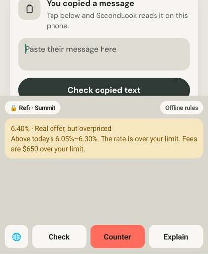 | 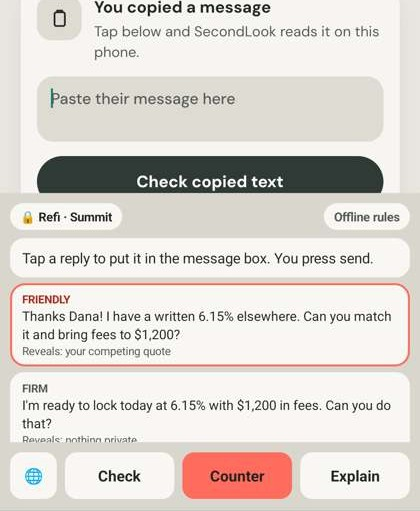 | 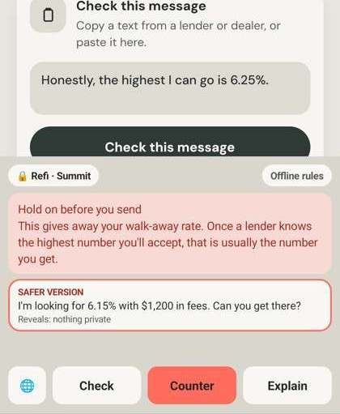 | 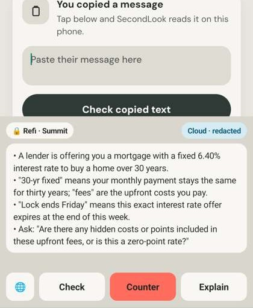 |
|:-:|:-:|:-:|:-:|
| Check: over your limit | Counter: three replies | Leak guard + safer version | Explain, Cloud · redacted |

**SecondLook for Chrome** (from the [extension test](#tests), Chromium):

| 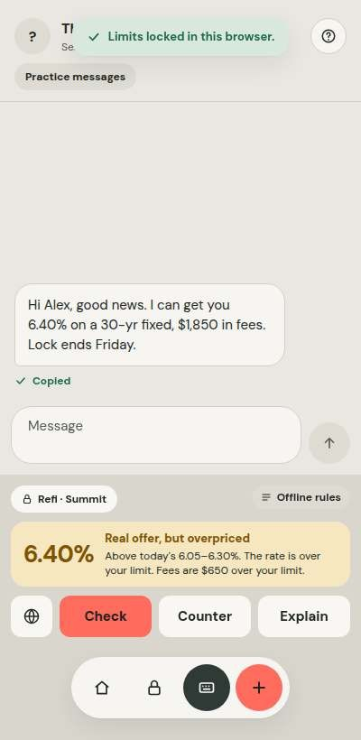 | 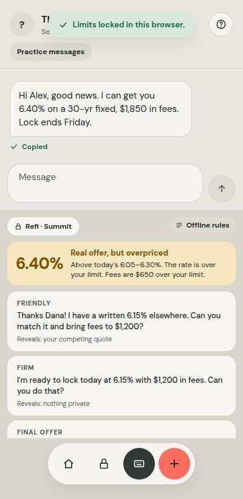 | 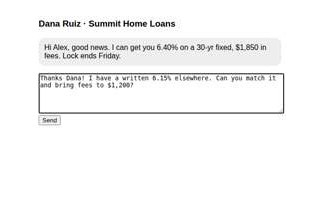 | 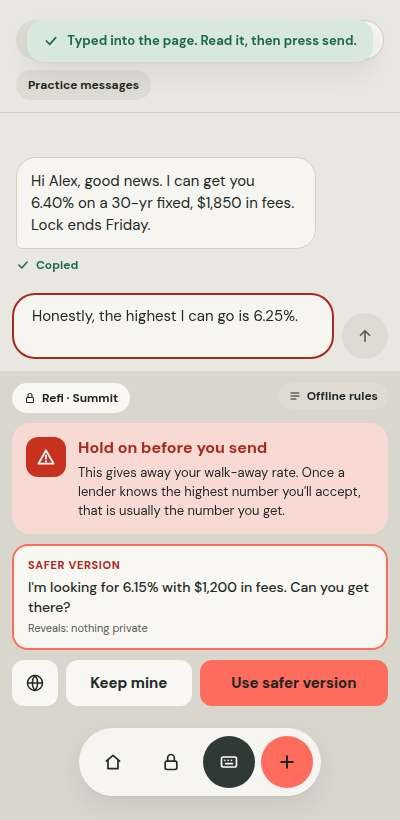 |
|:-:|:-:|:-:|:-:|
| Right-click → verdict | Counter | Reply typed into the page | Your own draft → leak guard |

**The app** (rendered by the browser test harness with sample data):

| 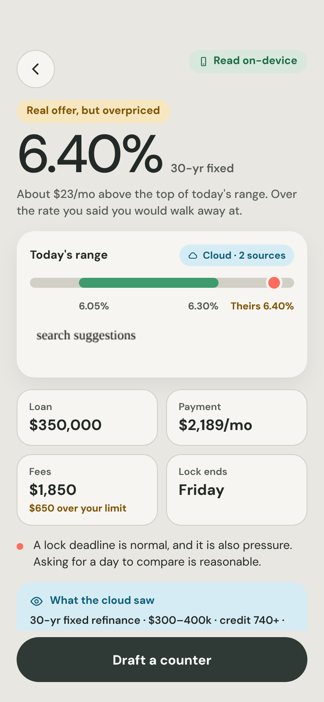 | 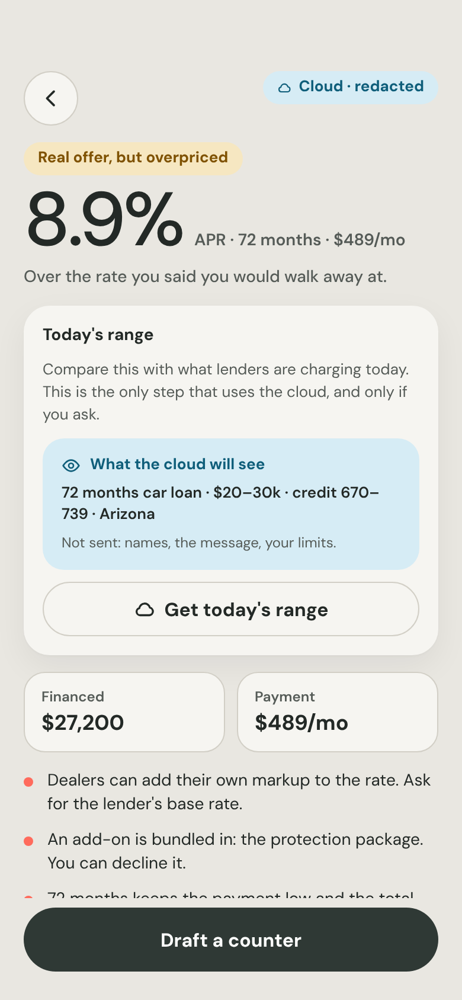 |  | 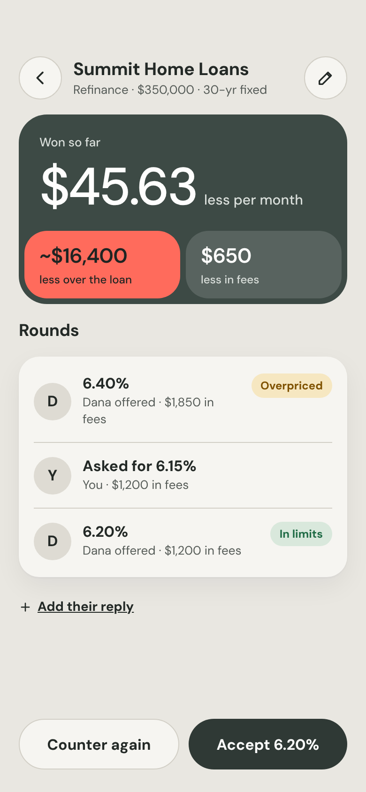 |
|:-:|:-:|:-:|:-:|
| Verdict, on-device | Verdict, cloud · redacted | Pick your reply | Rounds and savings |

|  |  |  |
|:-:|:-:|:-:|
| Home, dark | Keyboard panel in the app | Scam verdict |

## What it does

- **Check:** a verdict in one tap. Scam, needs more detail, overpriced or competitive, with the
  money first ("About $23/mo above the top of today's range").
- **Counter:** three replies (friendly, firm, final offer). Each shows "Within your limits" and
  "Reveals: …" before you pick it.
- **Explain:** the offer in plain words, with one question worth asking.
- **Leak guard:** blocks a reply that names your walk-away rate, agrees to more than your
  limits, cites a quote you do not hold, or mentions your credit score or deadline when you
  said not to. Offers a safer version.
- **Scam gate:** fee-before-funds, pressure, unknown links and similar patterns. No reply is
  offered for a scam, and the message is never sent to any model.
- **Rounds:** a timeline of offers and counters with what you have won so far.

### Where you type

The same Check · Counter · Explain panel on every platform:

| Platform | How you reach it | Lives in |
|---|---|---|
| iPhone | **SecondLook keyboard**: switch with the globe key in any app. Also "Check copied text"; Send reopens Messages with the reply filled in. | [`targets/keyboard`](targets/keyboard) |
| Android | **SecondLook keyboard**, an Android keyboard: turn it on from the Keyboard tab. Also highlight text in any app → "SecondLook" next to Copy and Share. | [`SecondLookKeyboardService.kt`](modules/secondlook-ai/android/src/main/java/expo/modules/secondlookai/SecondLookKeyboardService.kt) |
| Web / Chrome | **SecondLook for Chrome**: select a lender's message on any site → right-click → SecondLook. The side panel shows the verdict and types the reply you pick into the page. A website cannot install a keyboard, so this is the web's equivalent. | [`extension/`](extension/README.md) |

In every case you press send yourself, and the walk-away rate is never typed or sent.

## Where Firebase AI Logic is called

| Platform | File | What to look for |
|---|---|---|
| All | [`src/ai/router.ts`](src/ai/router.ts) | The privacy router: the one place that decides which mode a prompt gets. |
| Web (Chrome, Gemini Nano) | [`src/ai/platform.web.ts`](src/ai/platform.web.ts) | `getAI`, `getGenerativeModel(ai, { mode: InferenceMode… })`, `response.inferenceSource` |
| iOS (Apple Foundation Models) | [`modules/secondlook-ai/ios/SecondLookAIModule.swift`](modules/secondlook-ai/ios/SecondLookAIModule.swift) | `FirebaseAI.firebaseAI`, `SystemLanguageModel`, `HybridModel(primary:secondary:)`, `generativeModelSession` |
| Android (Gemini Nano) | [`SecondLookAIModule.kt`](modules/secondlook-ai/android/src/main/java/expo/modules/secondlookai/SecondLookAIModule.kt) | `Firebase.ai(...).generativeModel(onDeviceConfig = OnDeviceConfig(mode = …))` |
| Android keyboard | [`SecondLookKeyboardService.kt`](modules/secondlook-ai/android/src/main/java/expo/modules/secondlookai/SecondLookKeyboardService.kt) | `explain()`: `ONLY_ON_DEVICE` with Gemini Nano, else the redacted text to the cloud |
| Chrome extension | [`extension/panel.html`](extension/panel.html) | The side panel hosts the web app in a frame with `allow="language-model"`, so the web adapter above can use Chrome's Gemini Nano |

### Firebase products used

| Product | Used for | Where |
|---|---|---|
| Firebase AI Logic | On-device, redacted cloud and grounded cloud generation | [Above](#where-firebase-ai-logic-is-called) |
| App Check | Required for AI Logic: reCAPTCHA Enterprise on the web, debug provider in the test builds | [`platform.web.ts`](src/ai/platform.web.ts), [`SecondLookShared.kt`](modules/secondlook-ai/android/src/main/java/expo/modules/secondlookai/SecondLookShared.kt), [`SecondLookAIModule.swift`](modules/secondlook-ai/ios/SecondLookAIModule.swift) |
| Remote Config | Model names, the market-range switch and extra scam rules, changeable without a release | `cloud_model`, `benchmark_model`, `benchmark_enabled`, `scam_rules` |
| Anonymous Auth | Signs in the web app before cloud calls | [`platform.web.ts`](src/ai/platform.web.ts) |
| Hosting | The web app and the Chrome extension's panel | https://secondlook-7b7d5.web.app |

## Architecture

The animated diagram at the top shows one message end to end:

1. **Their text** is copied from the chat (or selected on a web page).
2. **Rules + math** run first, in code: the scam check and the loan math. A scam stops here.
3. **Firebase AI Logic** routes the prompt. Private text goes to the **on-device model**
   (Apple Foundation Models or Gemini Nano). Only what the device allows out reaches the
   **cloud model**, and only the market range uses **Google Search**.
4. **Locked limits** (behind a PIN) never enter a prompt. The model returns words with
   placeholders; **fill + guard** puts the numbers in and blocks anything that leaks.
5. **Your reply**: three drafts, and you press send.

```
┌──────────────────────── Expo app (TypeScript) ─────────────────────────┐
│  Screens: Home · Deal File · Limits + PIN · Verdict · Drafts · Rounds  │
│  Engine (src/engine, pure TS): scam rules · redactor · loan math ·     │
│          leak guard · drafts · pack. 48 unit tests, no model needed.   │
│  AI router (src/ai/router.ts): private → on-device only,               │
│          redacted → hybrid, market range → cloud + Search grounding    │
└──────┬───────────────────────────┬──────────────────────────┬──────────┘
       │ Expo module (Swift/Kotlin) │ Firebase JS SDK (web)     │ limits pack
       ▼                            ▼                           ▼
 Firebase AI Logic hybrid inference                   Keyboards / extension
   on-device: Apple Foundation Models ·                 iPhone keyboard (Swift)
              Gemini Nano (AICore) · Gemini Nano (Chrome) Android keyboard (Kotlin)
   cloud:     Gemini (+ Grounding with Google Search)    Chrome side panel
```

## Safety and privacy

- Limits, PIN and Deal File stay on the device (Keychain / Keystore; browser storage on the
  web). There is no account and no server copy. "Erase everything" removes them.
- A private prompt is only ever given to an on-device model.
- The cloud sees either redacted text (only when there is no on-device model, and only if the
  setting is on) or the coarse facts for the market range (only when you ask).
- Scam messages are judged by code and go nowhere.
- The keyboards and the extension never send anything: they type a reply you picked, and you
  press send.
- The Chrome extension can only act on the tab you right-clicked in, and the web app accepts
  messages only from the extension's fixed id.

## Tests

| Suite | What it proves | Where |
|---|---|---|
| Engine unit tests (48) | Loan math to the cent, extraction, scam rules, redaction, leak guard, drafts, pipeline | `npm test` |
| Browser scenarios (19) | Full negotiation, cloud fallback, offline, scam, PIN, erase, in headless Chrome | `npm run preview:test` · [Tests workflow](.github/workflows/test.yml) |
| Android emulator (21 steps) | The APK on Android 14: select text → SecondLook, the keyboard panel, and the Android keyboard end to end, including a live Firebase AI Logic call from inside the keyboard | [`android-emulator.yml`](.github/workflows/android-emulator.yml) |
| Chrome extension (8 checks) | Right-click → verdict → reply typed into the page; leak guard and safer version | [`extension-test.yml`](.github/workflows/extension-test.yml) |
| Native builds | iOS app + keyboard extension and Android APK compile on every run | [`ios-unsigned.yml`](.github/workflows/ios-unsigned.yml) · [`android-apk.yml`](.github/workflows/android-apk.yml) |

## Honest scope

| Part | State |
|---|---|
| Web app and Chrome's Gemini Nano | Live; on-device message check confirmed in desktop Chrome. |
| Android app and keyboard | Passes 21/21 emulator steps. Emulators have no Gemini Nano, so on-device on Android still needs a supported phone. |
| Chrome extension | Passes 8/8 checks in Chromium against a local build. |
| iPhone app and keyboard | Compile in CI. The on-phone keyboard tests ([T1–T4](docs/T1-T4.md)) are pending. |
| Today's market range | On the Gemini free tier, Grounding with Google Search is not available for Gemini 3 and newer models, so this step needs a paid (Blaze) project. Without it the app says it could not reach the cloud, and the verdict still uses your limits. |
| Hybrid APIs | Marked Experimental by Firebase. |

## Run it locally

**You need:** Node 22.13 or newer. For native builds, Android Studio (Android) or a Mac with
Xcode (iOS); on Windows, the iOS build runs on GitHub Actions.

1. Install and run the engine tests.
   ```bash
   npm install            # if a version is rejected: npm run setup:deps
   npx expo install --fix # aligns versions with the installed Expo SDK
   npm test               # 48 engine tests
   ```
2. Start the web app. With no Firebase configuration it still runs on the built-in rules and
   shows "Offline rules" badges.
   ```bash
   npm run web
   ```
3. Turn on the models: follow [SETUP.md](SETUP.md) (Firebase project, App Check, Remote
   Config; about 30 minutes of console work), then copy `.env.example` to `.env`.
4. Native builds use Expo development builds (not Expo Go), because of the native module.
   ```bash
   npx expo run:android   # Android emulator or device
   npx expo run:ios       # on a Mac
   ```
5. Load the Chrome extension from [`extension/`](extension/README.md).

**Try it without a real quote:** Home → "Load sample deals" adds two made-up deals. The
Keyboard tab is a practice chat with a made-up lender, dealer and scam message.

## Built during the hackathon

Everything in this repository was created during the submission period (Nov 11–30, 2026):

- The TypeScript engine (scam rules, redactor, loan math, leak guard, drafts) and its tests.
- The Expo app for iPhone, Android and the web, following the "SecondLook" app concept.
- The privacy router and the three Firebase AI Logic adapters (Swift, Kotlin, web).
- The iPhone keyboard extension, the Android keyboard and the Chrome extension.
- Firebase setup: AI Logic, App Check on every platform, Remote Config, Anonymous Auth, Hosting.
- CI: unit and browser tests, iOS and Android builds, the Android emulator test, the
  Chromium extension test, and the animated architecture diagram.

Third-party pieces: Expo / React Native, the Firebase SDKs, the DM Sans typeface (SIL Open Font
License), and in CI Playwright and the Android emulator runner. An AI coding assistant
(Claude) was used to write code, tests and documentation.

## License

[Apache 2.0](LICENSE).
